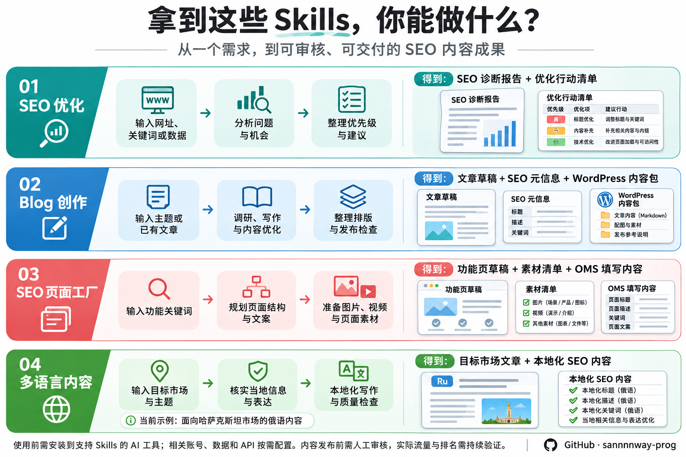

# SEO 内容工作流 Skills

把选词、分析、写作、页面制作和本地化经验，整理成可以复用的 AI 工作流程。

这套 Skills 面向 SEO 内容同学、内容运营和需要协作交付内容的团队。安装并配置所需工具后，可以让 AI 按流程协助完成具体成果。

## 选择你需要的工作流

| 类别 | 可以帮你做什么 | 典型成果 |
| --- | --- | --- |
| [SEO 优化](https://github.com/sannnnway-prog/seo-optimization-skills) | 分析关键词、竞品、页面内容、内外链和技术问题，整理优化优先级 | SEO 诊断报告、关键词机会、优化行动清单 |
| [Blog 创作](https://github.com/sannnnway-prog/blog-creation-skills) | 从主题开始写文章，或优化已有文章，补齐元信息、FAQ、内链和排版 | 文章草稿、SEO 元信息、WordPress 内容包 |
| [SEO 页面工厂](https://github.com/sannnnway-prog/seo-page-factory) | 从功能关键词出发，规划页面结构、文案及图片视频素材 | 功能页草稿、素材清单、OMS 填写内容 |
| [多语言内容](https://github.com/sannnnway-prog/multilingual-content-skills) | 根据目标市场核实信息、调整语言表达并完成本地化内容 | 目标市场文章、本地化 SEO 内容；当前包含哈萨克斯坦市场俄语工作流 |

## 如何开始

1. 打开对应类别的仓库，查看其中的 Skills 和使用说明。
2. 安装到支持 Skills 的 AI 工具，并按需配置相关账号、数据和 API。
3. 提供主题、关键词、网址或已有文章，说明希望获得的成果。
4. 检查事实、业务口径和排版，人工审核后再发布。

[团队手动同步面板（Windows / macOS）](https://github.com/sannnnway-prog/codex-skills-sync-tool)可用于在本地与 GitHub 之间手动更新 Skills，具体安装和冲突处理方式请查看面板仓库说明。

Skills 提供工作方法与交付规范。实际排名、流量和转化需要结合数据持续验证；涉及外部系统的操作仍需相应账号、权限和审核。
